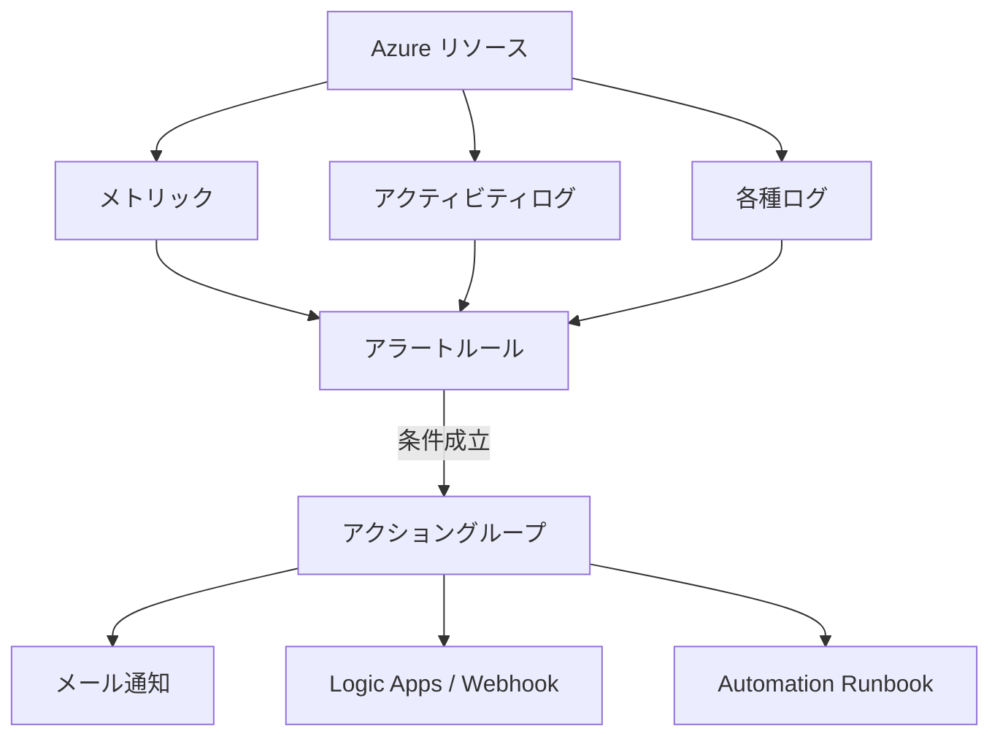
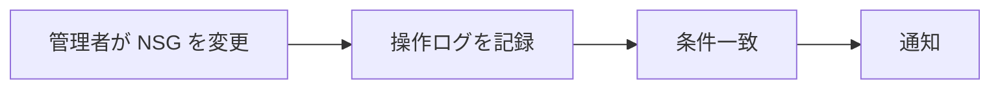
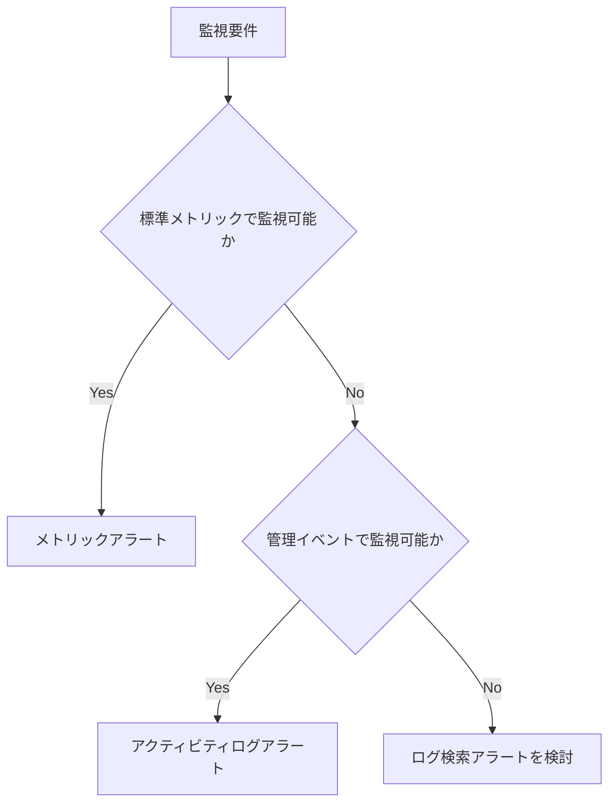

# Azure Monitor アラートルール

## 1. アラートルールとは

Azure Monitor のアラートルールとは、Azure リソースの稼働状況や操作履歴、ログなどを監視し、あらかじめ設定した条件を満たした場合に異常や特定のイベントを検知する機能である。アクショングループと組み合わせることで、管理者への通知や自動復旧処理につなげることができる。



## 2. なぜアラートルールを使用するのか

ダッシュボード監視では、管理者が定期的に画面を確認する必要があり、確認していない時間帯の異常検知が遅れる可能性がある。アラートルールでは、定義した条件に基づいて自動的に異常を検知できる。

### 2.1 ダッシュボード監視との比較

| 比較項目 | ダッシュボード監視 | アラートルール監視 |
|---|---|---|
| 監視方法 | 目視確認（Pull 型） | 自動判定（Push 型） |
| 異常検知 | 管理者の判断 | システムによる判断 |
| 監視タイミング | 画面確認時 | 評価頻度やイベントに基づく |
| 夜間・休日 | 目視監視には人員が必要 | 自動検知可能 |
| 通知 | 原則なし | メールなどで自動通知 |
| 運用負荷 | 比較的高い | 軽減可能 |
| 自動復旧 | 別途実装が必要 | アクショングループとの連携 |
| 得意な用途 | 傾向分析・状況把握 | 異常検知・初動対応 |

### 2.2 メリット

- 異常の早期検知：画面を確認していない時間帯でも検知できる。
- 運用負荷の軽減：定期的な目視確認作業を削減できる。
- 監視品質の均一化：統一された基準で判断できる。
- 初動対応の迅速化：関係者へ自動通知できる。
- 運用の自動化：Azure Automation や Logic Apps と連携できる。

**アラートルールで異常を検知し、ダッシュボードで詳細な状況や原因を確認する**という組み合わせが効果的である。

## 3. 各種アラートルールの特徴と違い

### 3.1 メトリックアラート（Metric Alert）

Azure リソースから収集される数値データを監視し、しきい値などの条件に合致した場合に発報する。

- 標準プラットフォームメトリックでは原則として診断設定や Log Analytics への転送が不要。
- 比較的短い間隔で監視できる。
- 静的しきい値と、対応するメトリックでは動的しきい値を利用できる。

例：VM の CPU 使用率の直近5分間の平均が80%を超過した場合に発報する。

| リソース | 監視内容 |
|---|---|
| Virtual Machine | CPU 使用率、ディスク I/O |
| Azure Firewall | スループット、Firewall ヘルス |
| Storage Account | トランザクション数、可用性 |
| Application Gateway | 異常なバックエンドホスト数 |
| Azure SQL Database | CPU 使用率、DTU 使用率 |

### 3.2 アクティビティログアラート（Activity Log Alert）

アクティビティログに記録されるイベントを監視する。主にコントロールプレーン（管理プレーン）の操作を対象とする。

- リソースの作成・変更・削除を監視できる。
- Service Health や Resource Health のイベントも監視できる。
- Log Analytics への転送は不要。
- 数値ではなくイベントの属性を条件に指定する。
- アラートルール自体は無料（通知方法によって別途費用が発生する）。



| カテゴリ | 監視内容 |
|---|---|
| Administrative | VM の削除、NSG の変更、RBAC ロール割り当て、Policy 割り当て変更 |
| ServiceHealth | Azure サービス障害・計画メンテナンス |
| ResourceHealth | リソース正常性の変化 |

VM 内部のイベントログや Blob へのアクセスなど、データプレーンの操作は原則として対象外である。

### 3.3 ログ検索アラート（Log Search Alert）

Azure Monitor Logs に蓄積されたログに対して KQL（Kusto Query Language）を定期実行し、検索結果が条件に合致した場合に発報する。

- 検索・集計・フィルタリング・結合など柔軟な条件を設定できる。
- 複数のログやリソースを横断した監視が可能。
- 対象ログの事前収集が必要。
- ログ取り込み遅延や評価頻度を考慮する必要がある。

Azure Firewall の拒否通信を抽出する KQL の例（リソース固有テーブル）：

```kusto
AZFWNetworkRule
| where Action == "Deny"
```

| リソース・ログ | 監視内容 |
|---|---|
| Azure Firewall | 特定の宛先への拒否通信 |
| Virtual Machine | Windows イベントログのエラー、Heartbeat の途絶 |
| Storage Account | 特定のアクセスエラー |
| Application Insights | アプリケーションの例外 |
| AzureActivity | 短時間で繰り返された管理操作 |

### 3.4 比較

| 比較項目 | メトリック | アクティビティログ | ログ検索 |
|---|---|---|---|
| 監視データ | 数値 | 管理イベント | ログ |
| 目的 | 性能・稼働監視 | 操作・イベント監視 | 詳細な事象の監視 |
| 条件 | しきい値 | イベント属性 | KQL と評価条件 |
| 評価方式 | 定期評価 | イベントベース | 定期評価 |
| 検知速度 | 比較的速い | イベント記録後 | 取り込み・評価頻度に依存 |
| 柔軟性 | 中 | 限定的 | 高 |
| KQL | 不要 | 不要 | 必要 |
| Log Analytics | 原則不要 | 不要 | 通常必要 |
| 診断設定 | 標準メトリックでは不要 | 不要 | ログの種類による |
| 料金 | 有料枠あり | 無料 | 原則有料 |
| リソースタイプ | Microsoft.Insights/metricAlerts | Microsoft.Insights/activityLogAlerts | Microsoft.Insights/scheduledQueryRules |

料金は監視対象数、評価頻度、ログ収集量、通知方法などによって異なる。

### 3.5 選定方法



## 4. アラートルールの構成要素

| 構成要素 | 説明 |
|---|---|
| スコープ | 何を監視するか |
| シグナル | どのメトリックやログを監視するか |
| 条件 | どのような状態を異常と判断するか |
| 評価頻度 | どの程度の間隔で評価するか |
| 評価期間 | どの程度の期間のデータを評価するか |
| アクショングループ | 検知後の通知・処理 |
| 重大度 | 事象の重要度 |
| 有効・無効 | ルールを稼働させるか |

### 4.1 評価頻度と評価期間

評価頻度1分、評価期間5分、集計方法 Average、しきい値80%の場合、1分ごとに直近5分間の平均値が80%を超えているか評価する。

| 評価時刻 | 評価対象期間 |
|---|---|
| 10:05 | 10:00〜10:05 |
| 10:06 | 10:01〜10:06 |
| 10:07 | 10:02〜10:07 |

### 4.2 アクショングループ

通知先や実行する処理を定義する Azure リソースである。複数のアラートルールから共通のアクショングループを参照できる。

### 4.3 重大度（Severity）

| 重大度 | レベル | 運用上の定義例 |
|---|---|---|
| Sev 0 | Critical | システム全体停止 |
| Sev 1 | Error | 主要機能の障害 |
| Sev 2 | Warning | CPU 使用率上昇 |
| Sev 3 | Informational | 運用上の確認事項 |
| Sev 4 | Verbose | 軽微な事象 |

重大度だけで通知先が自動的に変わるわけではない。アクティビティログアラートではルール作成時に重大度を指定しない。

## 5. Azure PowerShell による作成

### 5.1 使用するコマンドレット

| 対象 | コマンドレット |
|---|---|
| アクショングループ | New-AzActionGroup |
| メトリック | Add-AzMetricAlertRuleV2 |
| アクティビティログ | New-AzActivityLogAlert |
| ログ検索 | New-AzScheduledQueryRule |

### 5.2 事前準備

Az.Monitor、Az.Accounts、Az.Compute、Az.OperationalInsights を利用する。リソースグループ、VM、ワークスペースは作成済みとし、変数は実環境に合わせて変更する。

```powershell
Connect-AzAccount
$SubscriptionId = "<Subscription ID>"
Set-AzContext -SubscriptionId $SubscriptionId
$ResourceGroupName = "rg-monitor"
$Location = "japaneast"
$VMResourceGroupName = "rg-vm"
$VMName = "vm-test"
$WorkspaceName = "law-monitor"
$ActionGroupName = "ag-monitor"
$EmailAddress = "admin@example.com"
```

### 5.3 アクショングループの作成

```powershell
$EmailReceiver = New-AzActionGroupEmailReceiverObject `
    -Name "Administrator" `
    -EmailAddress $EmailAddress `
    -UseCommonAlertSchema $true

$ActionGroup = New-AzActionGroup `
    -Name $ActionGroupName `
    -ResourceGroupName $ResourceGroupName `
    -Location "Global" `
    -GroupShortName "Monitor" `
    -EmailReceiver $EmailReceiver `
    -Enabled

$ActionGroupId = $ActionGroup.Id
```

GroupShortName は短縮名、EmailReceiver はメール通知先、UseCommonAlertSchema は共通アラートスキーマの利用を指定する。

### 5.4 メトリックアラートの作成

VM の CPU 使用率を監視する。

| 項目 | 設定値 |
|---|---|
| 名前 | alert-vm-cpu |
| メトリック | Percentage CPU |
| 集計方法 | Average |
| 条件 | GreaterThan 80 |
| 評価頻度 | 1分 |
| 評価期間 | 5分 |
| 重大度 | Sev 2 |

```powershell
$VM = Get-AzVM -ResourceGroupName $VMResourceGroupName -Name $VMName

$Criteria = New-AzMetricAlertRuleV2Criteria `
    -MetricName "Percentage CPU" `
    -MetricNamespace "Microsoft.Compute/virtualMachines" `
    -TimeAggregation "Average" `
    -Operator "GreaterThan" `
    -Threshold 80

Add-AzMetricAlertRuleV2 `
    -Name "alert-vm-cpu" `
    -ResourceGroupName $ResourceGroupName `
    -TargetResourceId $VM.Id `
    -Condition $Criteria `
    -WindowSize (New-TimeSpan -Minutes 5) `
    -Frequency (New-TimeSpan -Minutes 1) `
    -Severity 2 `
    -ActionGroupId $ActionGroupId `
    -Description "VMのCPU使用率を監視"

# 利用可能なメトリックの確認
Get-AzMetricDefinition -ResourceId $VM.Id

# 作成結果の確認
Get-AzMetricAlertRuleV2 -ResourceGroupName $ResourceGroupName -Name "alert-vm-cpu"
```

### 5.5 アクティビティログアラートの作成

サブスクリプション内で NSG の作成・更新操作が正常に完了したことを検知する。

| 項目 | 設定値 |
|---|---|
| 名前 | alert-nsg-write |
| スコープ | サブスクリプション全体 |
| カテゴリ | Administrative |
| 操作名 | Microsoft.Network/networkSecurityGroups/write |
| ステータス | Succeeded |

```powershell
$Scope = "/subscriptions/$SubscriptionId"
$Action = New-AzActivityLogAlertActionGroupObject -Id $ActionGroupId

$CategoryCondition = New-AzActivityLogAlertAlertRuleAnyOfOrLeafConditionObject `
    -Field "category" -Equal "Administrative"
$OperationCondition = New-AzActivityLogAlertAlertRuleAnyOfOrLeafConditionObject `
    -Field "operationName" -Equal "Microsoft.Network/networkSecurityGroups/write"
$StatusCondition = New-AzActivityLogAlertAlertRuleAnyOfOrLeafConditionObject `
    -Field "status" -Equal "Succeeded"

New-AzActivityLogAlert `
    -Name "alert-nsg-write" `
    -ResourceGroupName $ResourceGroupName `
    -Location "Global" `
    -Scope $Scope `
    -Condition @($CategoryCondition, $OperationCondition, $StatusCondition) `
    -Action $Action `
    -Enabled $true `
    -Description "NSGの作成・更新操作を検知"

Get-AzActivityLogAlert -ResourceGroupName $ResourceGroupName -Name "alert-nsg-write"
```

3条件すべてに一致した場合に発報する。NSG の個別セキュリティルール変更も検知する場合は `Microsoft.Network/networkSecurityGroups/securityRules/write` なども考慮する。

### 5.6 ログ検索アラートの作成

Azure Firewall の診断設定でネットワークルールログをリソース固有テーブルとして Log Analytics へ転送しておく。

| 項目 | 設定値 |
|---|---|
| 名前 | alert-firewall-deny |
| スコープ | Log Analytics ワークスペース |
| テーブル | AZFWNetworkRule |
| 測定方法 | 検索結果の行数 |
| 条件 | GreaterThan 100 |
| 評価頻度・期間 | 5分 |
| 重大度 | Sev 2 |

```powershell
$Workspace = Get-AzOperationalInsightsWorkspace `
    -ResourceGroupName $ResourceGroupName -Name $WorkspaceName

$Query = @'
AZFWNetworkRule
| where Action == "Deny"
'@

$Condition = New-AzScheduledQueryRuleConditionObject `
    -Query $Query `
    -TimeAggregation "Count" `
    -Operator "GreaterThan" `
    -Threshold 100 `
    -FailingPeriodNumberOfEvaluationPeriod 1 `
    -FailingPeriodMinFailingPeriodsToAlert 1

New-AzScheduledQueryRule `
    -Name "alert-firewall-deny" `
    -DisplayName "alert-firewall-deny" `
    -ResourceGroupName $ResourceGroupName `
    -Location $Workspace.Location `
    -Scope $Workspace.ResourceId `
    -CriterionAllOf $Condition `
    -EvaluationFrequency (New-TimeSpan -Minutes 5) `
    -WindowSize (New-TimeSpan -Minutes 5) `
    -Severity 2 `
    -ActionGroupResourceId $ActionGroupId `
    -AutoMitigate `
    -Enabled `
    -Description "Firewallの拒否通信を監視"

Get-AzScheduledQueryRule -ResourceGroupName $ResourceGroupName -Name "alert-firewall-deny"
```

AutoMitigate はアラートの自動解決を指定する。ワークスペース全体を対象とするため、特定の Firewall のみを監視する場合は KQL にリソースIDの条件を追加する。

## 6. コマンドによる作成方法の比較

| 設定項目 | メトリック | アクティビティログ | ログ検索 |
|---|---|---|---|
| 監視対象 | TargetResourceId | Scope | Scope |
| 評価条件 | Condition | Condition | CriterionAllOf |
| 評価頻度 | Frequency | — | EvaluationFrequency |
| 評価期間 | WindowSize | — | WindowSize |
| 通知先 | ActionGroupId | Action | ActionGroupResourceId |
| 重大度 | Severity | — | Severity |

## 7. 運用上の注意点

| 注意点 | 対応方針 |
|---|---|
| 過剰発報 | 適切なしきい値・評価期間を設定 |
| 通知先管理 | アクショングループを共通化 |
| ログ収集漏れ | 診断設定や DCR を確認 |
| コスト増大 | 評価頻度や監視対象数を見直す |
| 計画メンテナンス | アラート処理ルールで通知を抑制 |
| 障害対応 | 重大度に応じた手順を整備 |
| 設定漏れ | Azure Policy やスクリプトで管理 |
| 通知不達 | アクショングループと実際の発報をテスト |

過剰な通知によるアラート疲れ（Alert Fatigue）を防ぐため、実際の稼働状況や過去のデータに基づいて監視条件を継続的に見直す。

## 8. まとめ

- メトリックアラート：数値・性能・稼働状況の監視。
- アクティビティログアラート：Azure 上の操作・管理イベントの監視。
- ログ検索アラート：KQL による詳細かつ柔軟な監視。

適切なアラートルールの選定によって異常の早期検知、運用負荷の軽減、監視品質の向上を実現できる。Azure PowerShell による自動化で複数のサブスクリプションに統一された監視設定を展開できる。

## 参考資料

- [Azure Monitor のアラートの概要](https://learn.microsoft.com/ja-jp/azure/azure-monitor/alerts/alerts-overview)
- [Azure Monitor アラートの種類](https://learn.microsoft.com/ja-jp/azure/azure-monitor/alerts/alerts-types)
- [New-AzActionGroup](https://learn.microsoft.com/powershell/module/az.monitor/new-azactiongroup)
- [Add-AzMetricAlertRuleV2](https://learn.microsoft.com/powershell/module/az.monitor/add-azmetricalertrulev2)
- [New-AzActivityLogAlert](https://learn.microsoft.com/powershell/module/az.monitor/new-azactivitylogalert)
- [New-AzScheduledQueryRule](https://learn.microsoft.com/powershell/module/az.monitor/new-azscheduledqueryrule)
- [Azure Monitor の料金](https://azure.microsoft.com/ja-jp/pricing/details/monitor/)

> 監視対象・しきい値は説明用の例である。PowerShell コマンドは実環境へのデプロイ未検証のため、利用する Az モジュールのバージョンを含めて検証環境で確認すること。
