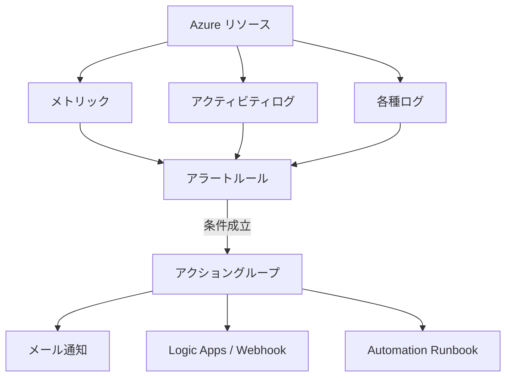
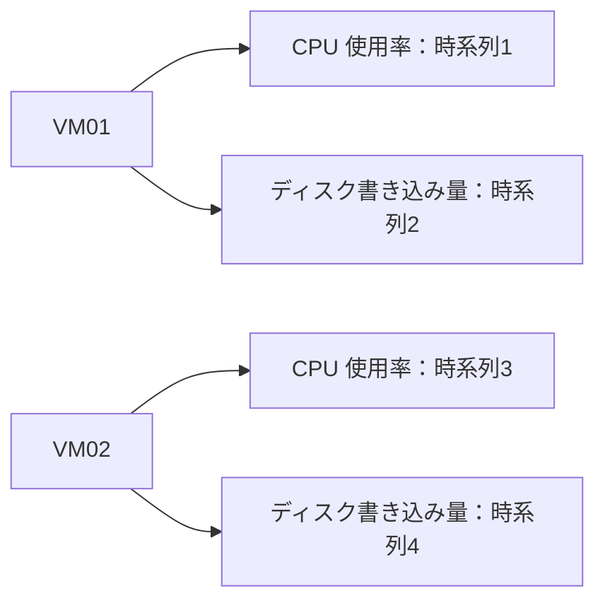

# Azure Monitor アラートルール

## 1. アラートルールとは

Azure Monitor のアラートルールとは、Azure リソースの稼働状況や操作履歴、ログなどを監視し、あらかじめ設定した条件を満たした場合に異常や特定のイベントを検知する機能である。アクショングループと組み合わせることで、管理者への通知や自動復旧処理につなげることができる。



## 2. なぜアラートルールを使用するのか

ダッシュボード監視では、管理者が定期的に画面を確認する必要があり、確認していない時間帯の異常検知が遅れる可能性がある。アラートルールでは、定義した条件に基づいて自動的に異常を検知できる。

### 2.1 ダッシュボード監視との比較

| 比較項目 | ダッシュボード監視 | アラートルール監視 |
|---|---|---|
| 監視方法 | 目視確認（Pull 型） | 自動判定（Push 型） |
| 異常検知 | 管理者の判断 | システムによる判断 |
| 監視タイミング | 画面確認時 | 評価頻度やイベントに基づく |
| 夜間・休日 | 目視監視には人員が必要 | 自動検知可能 |
| 通知 | 原則なし | メールなどで自動通知 |
| 運用負荷 | 比較的高い | 軽減可能 |
| 自動復旧 | 別途実装が必要 | アクショングループとの連携 |
| 得意な用途 | 傾向分析・状況把握 | 異常検知・初動対応 |

### 2.2 メリット

- 異常の早期検知：画面を確認していない時間帯でも検知できる。
- 運用負荷の軽減：定期的な目視確認作業を削減できる。
- 監視品質の均一化：統一された基準で判断できる。
- 初動対応の迅速化：関係者へ自動通知できる。
- 運用の自動化：Azure Automation や Logic Apps と連携できる。

**アラートルールで異常を検知し、ダッシュボードで詳細な状況や原因を確認する**という組み合わせが効果的である。

## 3. 各種アラートルールの特徴と違い

### 3.1 メトリックアラート（Metric Alert）

Azure リソースから収集される数値データを監視し、しきい値などの条件に合致した場合に発報する。

- 標準プラットフォームメトリックでは原則として診断設定や Log Analytics への転送が不要。
- 比較的短い間隔で監視できる。
- 静的しきい値と、対応するメトリックでは動的しきい値を利用できる。

例：VM の CPU 使用率の直近5分間の平均が80%を超過した場合に発報する。

| リソース | 監視内容 |
|---|---|
| Virtual Machine | CPU 使用率、ディスク I/O |
| Azure Firewall | スループット、Firewall ヘルス |
| Storage Account | トランザクション数、可用性 |
| Application Gateway | 異常なバックエンドホスト数 |
| Azure SQL Database | CPU 使用率、DTU 使用率 |

### 3.2 アクティビティログアラート（Activity Log Alert）

アクティビティログに記録されるイベントを監視する。主にコントロールプレーン（管理プレーン）の操作を対象とする。

- リソースの作成・変更・削除を監視できる。
- Service Health や Resource Health のイベントも監視できる。
- Log Analytics への転送は不要。
- 数値ではなくイベントの属性を条件に指定する。
- ログ監視と違い、イベントの詳細な条件指定はできない。


| カテゴリ | 監視内容 |
|---|---|
| Administrative | VM の削除、NSG の変更、RBAC ロール割り当て、Policy 割り当て変更 |
| ServiceHealth | Azure サービス障害・計画メンテナンス |
| ResourceHealth | リソース正常性の変化 |

VM 内部のイベントログや Blob へのアクセスなど、データプレーンの操作は原則として対象外である。

### 3.3 ログ検索アラート（Log Search Alert）

Azure Monitor Logs に蓄積されたログに対して KQL（Kusto Query Language）を定期実行し、検索結果が条件に合致した場合に発報する。

- 検索・集計・フィルタリング・結合など柔軟な条件を設定できる。
- 複数のログやリソースを横断した監視が可能。
- 対象ログの事前収集が必要。
- ログ取り込み遅延や評価頻度を考慮する必要がある。

Azure Firewall の拒否通信を抽出する KQL の例（リソース固有テーブル）：

```kusto
AZFWNetworkRule
| where Action == "Deny"
```

| リソース・ログ | 監視内容 |
|---|---|
| Azure Firewall | 特定の宛先への拒否通信 |
| Virtual Machine | Windows イベントログのエラー、Heartbeat の途絶 |
| Storage Account | 特定のアクセスエラー |
| Application Insights | アプリケーションの例外 |
| AzureActivity | 短時間で繰り返された管理操作 |

### 3.4 比較

| 比較項目 | メトリック | アクティビティログ | ログ検索 |
|---|---|---|---|
| 監視データ | 数値 | 管理イベント | ログ |
| 目的 | 性能・稼働監視 | 操作・イベント監視 | より詳細な事象の監視 |
| 条件 | しきい値 | イベント属性 | KQL と評価条件 |
| 評価方式 | 定期評価 | イベントベース | 定期評価 |
| 検知速度 | 比較的速い | イベント記録後 | 取り込み・評価頻度に依存 |
| 柔軟性 | 中 | 限定的 | 高 |
| KQL | 不要 | 不要 | 必要 |
| Log Analytics | 原則不要 | 不要 | 通常必要 |
| 診断設定 | 標準メトリックでは不要 | 不要 | ログの種類による |
| リソースタイプ | Microsoft.Insights/metricAlerts | Microsoft.Insights/activityLogAlerts | Microsoft.Insights/scheduledQueryRules |
| 選定基準 | 標準メトリックで監視可能か | 管理イベントで監視可能か | より詳細なログによる条件が必要か |


## 4. アラートルールの構成要素

| 構成要素 | 説明 |
|---|---|
| スコープ | 何を監視するか |
| シグナル | どのメトリックやログを監視するか |
| 条件 | どのような状態を異常と判断するか |
| 評価頻度 | どの程度の間隔で評価するか |
| 評価期間 | どの程度の期間のデータを評価するか |
| アクショングループ | 検知後の通知・処理 |
| 重大度 | 事象の重要度 |
| 有効・無効 | ルールを稼働させるか |

### 4.1 評価頻度と評価期間

評価頻度1分、評価期間5分、集計方法 Average、しきい値80%の場合、1分ごとに直近5分間の平均値が80%を超えているか評価する。

| 評価時刻 | 評価対象期間 |
|---|---|
| 10:05 | 10:00〜10:05 |
| 10:06 | 10:01〜10:06 |
| 10:07 | 10:02〜10:07 |

### 4.2 アクショングループ

通知先や実行する処理を定義する Azure リソースである。複数のアラートルールから共通のアクショングループを参照できる。


### 4.3 重大度（Severity）

| 重大度 | レベル | 運用上の定義例 |
|---|---|---|
| Sev 0 | Critical | システム全体停止 |
| Sev 1 | Error | 主要機能の障害 |
| Sev 2 | Warning | CPU 使用率上昇 |
| Sev 3 | Informational | 運用上の確認事項 |
| Sev 4 | Verbose | 軽微な事象 |

重大度だけで通知先が自動的に変わるわけではない。アクティビティログアラートではルール作成時に重大度を指定しない。

## 5. アラートルールの料金と注意点

アラートルールは種類によって課金体系が異なる。メトリックアラートとログ検索アラートでは、無料枠等を除き、アラートが発報しなくても監視を行うこと自体に料金が発生する。

### 5.1 時系列（Time Series）とは

時系列とは、同じ監視対象・メトリック・ディメンションの組み合わせについて、時間に沿って記録された一連の数値データである。

| 時刻 | VM01 の CPU 使用率 | VM02 の CPU 使用率 |
|---|---:|---:|
| 10:00 | 20% | 40% |
| 10:01 | 30% | 50% |
| 10:02 | 80% | 60% |
| 10:03 | 50% | 30% |

上記ではデータ点は8個あるが、時系列は2本である。1分ごとにデータを取得しても、取得回数に応じて時系列数が増えるわけではない。



VM2台について2種類のメトリックを個別監視する場合、合計4時系列となる。

#### ディメンションとは

ディメンションはメトリックを分類する属性である。例えば Storage Account の Transactions を API 名（ApiName）ごとに分割して監視する場合、API ごとに独立した時系列となる。

| 監視方法 | 時系列数 |
|---|---:|
| 全 API のトランザクション数をまとめて監視 | 1 |
| GetBlob、PutBlob、DeleteBlob、ListBlobs を個別監視 | 4 |


均一な構成で全組み合わせを評価する場合の概算：

**時系列数 = リソース数 × メトリック数 × ディメンションの組み合わせ数**

実際にはルールごとに評価される系列数に依存する。同じ系列を複数ルールで監視する場合や、将来追加されるディメンション値も対象とする場合は注意する。

### 5.2 メトリックアラートの料金

監視する時系列数に応じて課金される。標準のメトリックアラートには最初の10時系列の月間無料枠があり、動的しきい値には追加料金がある。無料枠はルールごとに10本付与されるものではない。

| 監視構成 | 時系列数 |
|---|---:|
| VM1台 × CPU使用率 | 1 |
| VM10台 × CPU使用率 | 10 |
| VM20台 × 3メトリック | 60 |
| Storage 10台 × 1メトリック × 4 API | 40 |

例えば60時系列を1か月監視し、10時系列の無料枠がすべて利用可能な場合、課金対象は50時系列となる。

ルールを1つに集約しても、同じ時系列数を個別評価する限り、基本的に時系列課金は削減されない。

### 5.3 アクティビティログアラートの料金

アラートルール自体は無料である。管理操作や Service Health などの監視では、要件を満たせる場合に優先して利用するとよい。

ただし、通知方法やログの外部転送・長期保持には別途費用が発生する場合がある。

### 5.4 ログ検索アラートの料金

通常のログ検索アラートでは、評価頻度に応じたルール基本料金と、ディメンション分割による追加時系列料金が発生する。最初の1時系列は基本料金に含まれる。

| 評価頻度 | 1日あたりの評価回数（目安） |
|---|---:|
| 1分 | 1,440 |
| 5分 | 288 |
| 15分 | 96 |
| 60分 | 24 |

評価頻度が短いほど一般に基本料金が高くなる。評価期間とは別の設定であり、上記の回数は料金倍率を表すものではない。

#### Azure Firewall の監視例

3台の Firewall の拒否通信をまとめて評価する場合は1時系列、リソースIDをディメンションとして個別評価する場合は3時系列となる。

```
AZFWNetworkRule
| where Action == "Deny"
| summarize DenyCount = count()
```


集約監視と個別監視では検知結果が異なるため、料金だけで監視方法を決定しないこと。

概算式（1時系列以上を評価する場合）：

**月額料金 = 評価頻度に応じた基本料金 + 追加時系列単価 ×（時系列数 − 1）**

例えば基本料金150円、追加時系列単価15円と仮定した場合、3時系列では180円/月となる。複数ルールを1ルールに集約することで基本料金を削減できる場合がある。

なお、ログの取り込み・保持、対象テーブルのプランに応じたクエリ料金などは別途考慮する必要がある。

### 5.5 料金体系の比較

| 項目 | メトリック | アクティビティログ | ログ検索 |
|---|---|---|---|
| ルール基本料金 | 原則なし | 無料 | あり |
| 時系列課金 | あり | なし | 追加系列にあり |
| 評価頻度による基本料金差 | 原則なし | なし | あり |
| 動的しきい値の追加料金 | あり | — | — |
| ログ取り込み・保持料金 | 標準メトリックでは原則不要 | 転送等により発生 | 別途考慮 |
| 通知・連携処理の料金 | 別途考慮 | 別途考慮 | 別途考慮 |

### 5.6 コストを抑えるための設計

- 管理操作の監視には無料のアクティビティログアラートを優先する。
- メトリックアラートでは不要な監視項目やディメンションを絞る。
- ログ検索アラートでは必要な検知速度に応じて評価頻度を設定する。
- ログ検索アラートの集約は、個別評価の要件や制限を確認したうえで検討する。
- 不要になったルールは無効化または削除する。通知の抑制だけでは監視料金は止まらない。
- Azure Cost Management で実際の費用を確認する。

> 本章の金額は説明用の仮単価であり、実際の Azure 料金ではない。見積もり時には契約・通貨・対象リージョンに応じた公式料金表と無料枠の適用条件を確認すること。

## 6. 運用上の注意点

| 注意点 | 対応方針 |
|---|---|
| 過剰発報 | 適切なしきい値・評価期間を設定 |
| 通知先管理 | アクショングループを共通化 |
| ログ収集漏れ | 診断設定や DCR を確認 |
| コスト増大 | 評価頻度や監視対象数を見直す |
| 計画メンテナンス | アラート処理ルールで通知を抑制 |
| 障害対応 | 重大度に応じた手順を整備 |
| 設定漏れ | Azure Policy やスクリプトで管理 |
| 通知不達 | アクショングループと実際の発報をテスト |

過剰な通知によるアラート疲れを防ぐため、実際の稼働状況や過去のデータに基づいて監視条件を継続的に見直す。

## 7. まとめ

- メトリックアラート：数値・性能・稼働状況の監視。
- アクティビティログアラート：Azure 上の操作・管理イベントの監視。
- ログ検索アラート：KQL による詳細かつ柔軟な監視。

適切なアラートルールの選定によって異常の早期検知、運用負荷の軽減、監視品質の向上を実現できる。監視設計では、検知要件だけでなく、時系列数・評価頻度・ログ収集費用も考慮する必要がある。

## 参考資料

- [Azure Monitor のアラートの概要](https://learn.microsoft.com/ja-jp/azure/azure-monitor/alerts/alerts-overview)
- [Azure Monitor アラートの種類](https://learn.microsoft.com/ja-jp/azure/azure-monitor/alerts/alerts-types)
- [複数の時系列を監視するメトリックアラート](https://learn.microsoft.com/ja-jp/azure/azure-monitor/alerts/alerts-metric-multiple-time-series-single-rule)
- [Azure Monitor の料金](https://azure.microsoft.com/ja-jp/pricing/details/monitor/)
- [Azure 料金計算ツール](https://azure.microsoft.com/ja-jp/pricing/calculator/)
